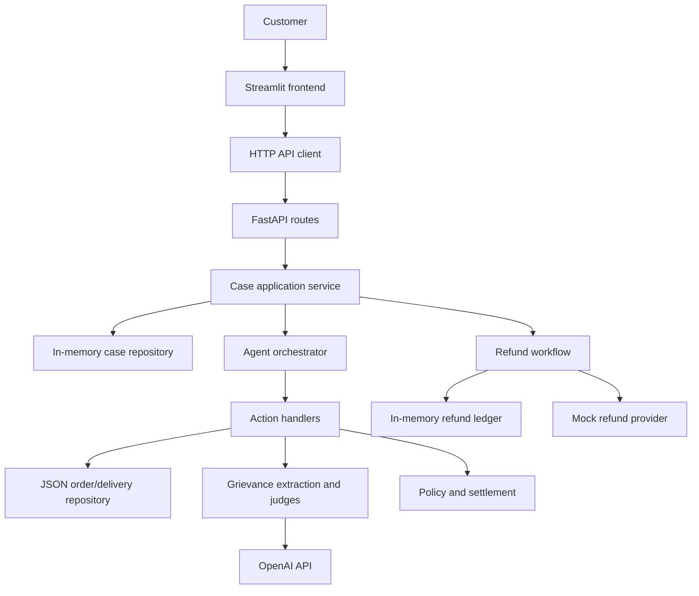

# RefundBench

RefundBench is a customer-support refund-resolution application. It provides
a Streamlit interface and a FastAPI backend for resolving customer complaints
using order and delivery data, LLM-assisted grievance evaluation, and
deterministic policy and settlement logic.

## What it does

For a submitted customer complaint, RefundBench follows this workflow:

1. Retrieve the order and delivery.
2. Extract grievances from the complaint.
3. Build evidence for each grievance and evaluate it with parallel judges.
4. Reach consensus, apply refund policy, and calculate a settlement.
5. Let the customer accept an approved refund through the interface.

Refund acceptance uses an order-based idempotency key in the current refund
workflow. Cases and refund records are currently held in process-local memory;
order and delivery data are read from JSON files in `data/`.

## Architecture



## Project structure

```text
.
├── app/
│   ├── agent/                 # Agent state, workflow, harness, action handlers
│   ├── application/cases/     # Case use cases and in-memory case repository
│   ├── domain/                # Order, delivery, grievance, and evidence models
│   ├── evaluation/            # Evidence, grievance extraction, judges, consensus
│   ├── infrastructure/        # LLM, JSON order access, observability
│   ├── interfaces/api/        # FastAPI routes, schemas, and mappers
│   ├── policy/                # Refund policy decisions
│   ├── response/              # Customer response generation
│   ├── settlement/            # Settlement and refund lifecycle
│   └── bootstrap.py           # Dependency wiring and API app factory
├── benchmark/                 # Golden-set runner, comparator, and result models
├── config/                    # Environment settings and logging setup
├── data/                      # JSON orders, deliveries, and agent test cases
├── frontend/                  # Streamlit UI and HTTP API client
├── tests/                     # Pytest suite
├── app.py                     # Streamlit entry point
├── backend.py                 # FastAPI ASGI entry point
└── requirements.txt
```

## Run locally

Create and activate a virtual environment, then install dependencies:

```bash
python3 -m venv .venv
source .venv/bin/activate
pip install -r requirements.txt
```

Configure the required API key and model in the environment or a root `.env`
file. OpenAI is the default provider:

```dotenv
OPENAI_API_KEY=your_api_key
OPEN_AI_MODEL=your_model_name
```

To use Groq instead, set `LLM_PROVIDER=GROQ`; `LLM_BASE_URL` is optional and
defaults to Groq's OpenAI-compatible endpoint. OpenAI uses the SDK's default
endpoint unless `LLM_BASE_URL` is explicitly set:

```dotenv
LLM_PROVIDER=GROQ
```

Start the FastAPI backend:

```bash
uvicorn backend:app --host 127.0.0.1 --port 8000
```

In a second terminal, activate the environment and start the Streamlit
frontend:

```bash
streamlit run app.py
```

The frontend uses `http://localhost:8000` by default. Set `BACKEND_URL` to
override the backend URL.

## Run tests

With the virtual environment active:

```bash
pytest
```

## Benchmark business dashboard

The dashboard is read-only and consumes the generated JSON artifacts in
`data/benchmark_results/`. If `output.txt` contains a saved benchmark report,
from the project root run `python -m benchmark.generate_dashboard` to
recalculate metrics offline and generate `case_results.json` and
`dashboard.json`. This command does not run evaluations or call an LLM.
Then launch the dashboard with `streamlit run app.py`. Opening or refreshing
the dashboard only reads the generated JSON.

If no saved benchmark report exists yet, first run
`python -m benchmark.runner` to evaluate the golden cases and save a report;
this evaluation may call the configured LLM provider and incur charges.
Then run the offline artifact-generation command above. If artifacts or the
saved report are missing, the dashboard shows an empty state rather than
fabricating results.

Business assumptions used for estimated savings and review effort are saved
with the dashboard artifact. They can be set through the benchmark runner's
CLI options or the corresponding `REFUNDBENCH_*` environment variables.
Simulated CSAT is a deterministic proxy, not customer feedback, and a single
run does not represent a historical trend.

Latency is measured by the `TOTAL_AGENT` event from orchestrator entry through
workflow completion, including internal tools and decision work but excluding
surrounding application-service bookkeeping. Latency percentiles use only
measured cases and include measured/missing coverage. Token aggregates are
reported only when telemetry is complete across all cases; estimated LLM cost
requires complete input/output token telemetry and configured prices matched
to the model/provider/endpoint.

Estimated net savings count manual handling as avoided only for automatic
approvals whose deterministic decision, refund amount, and escalation
comparisons all pass. The estimate subtracts assumed escalation review labor
and estimated LLM operating cost. It excludes error costs, churn,
infrastructure, and other unmodeled support costs, so it is not realized
savings and may overstate economic impact.
